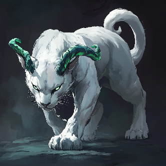
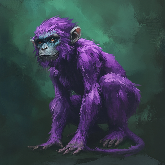

## Raiju

Uma raça de panteras que vive nas densas florestas negras do continente de Bravia. Possuem uma sociedade tribal caçadora-coletora. Por não possuírem uma estrutura social muito avançada, são oficialmente classificadas como animais selvagens até hoje pelo Império Elfo Negro, não sendo considerado um povo civilizado. Por essa razão, evitam a maioria do controle imperial, mantendo a maioria dos seus costumes inalterados. No entanto, suas cabeças são consideradas troféus de alta estima pelos Elfos Negros e as florestas onde vivem possuem uma madeira extremamente cobiçada para fazer mobília, de forma que são constantemente expulsos de suas regiões naturais e hoje se tornaram uma raça ameaçada de extinção. Possuem um par de chifres verdes, representando sua afinidade com o elemento ar

* **Habilidades:** Toque elétrico, Garras e Presas (em construção), [Controle de Forma](../fatores/#controle-de-forma)  
* **Vantagens: +1 [PER](../../personagem/atributos/#percepção-per)**, **+1 [DEX](../../personagem/atributos/#destreza-dex)**, [Pulos Longos](../fatores/#pulos-longos), [Resistência (Cortante)](../fatores/#resistência-x), [Sentidos Apurados](../fatores/#sentidos-apurados)  
* **Desvantagens:** [Cabeça a Prêmio](../fatores/#cabeça-a-prêmio), [Fraqueza (Contundente)](../fatores/#fraqueza-x), [Fraqueza (Gelo)](../fatores/#fraqueza-x), [Pseudo-demônio](../fatores/#pseudo-demônio)  
* **Línguas:** Bestial, Élfico  

## Vanara

Uma raça de primatas de pequeno porte que vive nos pântanos do continente de Bravia. Pesando cerca de 30kg e tendo 1 m de altura, esse grupo de macacos possui um pelo roxo púrpura bem distinto das outras raças da região, que fica assim por tomar bastante chá de uma erva da região de cor turquesa. São ótimos construtores e engenheiros, capazes de erguer prédios e criar diversos mecanismos com ou sem a ajuda de magia, o que foi fundamental para construir uma civilização avançada mesmo nos territórios instáveis do pântano. Como armaduras costumam restringir o movimento dessa raça que preza pela sua agilidade, geralmente andam por aí sem usar roupas, contando apenas com seus pelos e pele, enquanto que quando realmente precisam equipar algo para proteção, geralmente usam armadura leve mínima para evitar que seus movimentos sejam restritos

* **Habilidades:** [Raiva Primal](../fatores/#raiva-primal)  
* **Vantagens: +2 [DEX](../../personagem/atributos/#destreza-dex)**, **+1 [INT](../../personagem/atributos/#intelecto-int)**, [Pulos Altos](../fatores/#pulos-altos), [Pulos Longos](../fatores/#pulos-longos), [Sentidos Apurados](../fatores/#sentidos-apurados), [Pés Ágeis](../fatores/#pés-ágeis), [Resistência (Cortante)](../fatores/#resistência-x)  
* **Desvantagens: -1 [RES](../../personagem/atributos/#resistência-res)**, [Desconfortável em Armaduras](../fatores/#desconfortável-em-armaduras)  
* **Línguas:** Bestial
