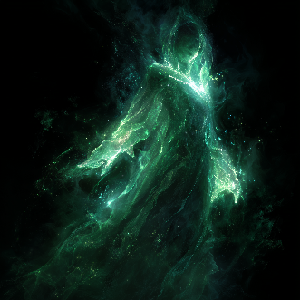
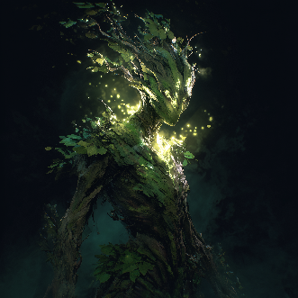
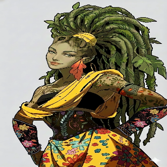
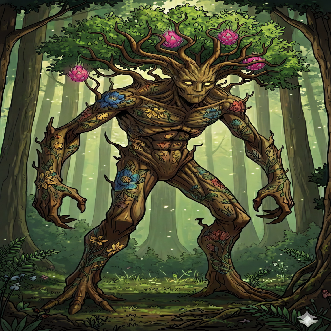

## Dríade

 

Uma das raras raças de espíritos, dríades são fae que surgem da amálgama das almas e life force residual de inúmeras plantas comuns que estiveram numa área de floresta devastada com uma grande quantidade de energia natural. Esses espíritos geralmente são extremamente ligados à seu local de nascença, agindo como guardiões da vida e do equilíbrio nas regiões que habitam. Essa ligação especial com seu local de nascença faz com que somente dentro de seu território, Dríades possam manifestar todo seu potencial, contando com uma quase onipresença e onisciência nessas regiões, além de poder despender energia para poder manipular o ambiente ao seu redor quase livremente. No entanto, essa natureza faz com que também não possam se afastar muito dos seus locais de nascença sem um receptáculo apropriado, no qual sua conexão com o território é temporariamente cortada e sua energia interna não se dissipa ao se afastar  

* **Habilidades:** [Local Vinculado](../fatores/#local-vinculado), [Onisciência Local](../fatores/#onisciência-local), [Onipresença Local](../fatores/#onipresença-local), [Zona Vinculada](../fatores/#zona-vinculada)  
* **Vantagens: +2 [DET](../../personagem/atributos/#determinação-det)**, **+2 [PER](../../personagem/atributos/#percepção-per)**, [Talento Nato](../fatores/#talento-nato), [Elemental](../fatores/#elemental), [Linguista Ancião](../fatores/#linguista-ancião), [Longevo](../fatores/#longevo)  
* **Desvantagens:** [Vínculo Local](../fatores/#vínculo-local), [Fraqueza (Fogo)](../fatores/#fraqueza-x), [Cabeça a Prêmio](../fatores/#cabeça-a-prêmio)  
* **Línguas:** Bestial, Élfico, Humano  

## Rue

 

Rues são uma variação de Treant, mas que específicamente se originam de plantas frutíferas, de árvores à arbustos. Neste grupo, a mana que geralmente se acumulava em seus corpos agora se acumula em seus frutos, que possuem propriedades especiais. Por isso, Rues não possuem núcleo de mana formado, sendo uma das poucas raças que podem sentir e interagir com a mana, mas são anucleadas. As frutas de cada indivíduo dessa raça são únicas e variam com a personalidade do indivíduo, sendo que alguns podem até produzir mais de um tipo de fruta de uma vez e elas podem crescer tão rápido quanto algumas unidades por dia. Assim como seus parentes Treants, também dependem dos nutrientes do solo e da luz pra sobreviver, porém, diferente deles, quase todos os Rues aprendem a se desprender do solo e caminhar livremente, sendo que um número impressionante desses indivíduos aprende, ainda, como caminhar em duas pernas  

* **Habilidades:** [Colheita Consistente](../fatores/#colheita-consistente), [Controle de Forma](../fatores/#controle-de-forma)  
* **Vantagens: +1 [INT](../../personagem/atributos/#intelecto-int)**, **+1 [DET](../../personagem/atributos/#determinação-det)**, [Regeneração Natural](../fatores/#regeneração-natural), [Fotossintético](../fatores/#fotossintético), [Resistência (Contundente)](../fatores/#resistência-x)  
* **Desvantagens:** [Fraqueza (Venenos)](../fatores/#fraqueza-x), [Fraqueza (Cortante)](../fatores/#fraqueza-x), [Enraizado](../fatores/#enraizado)  
* **Línguas:** Bestial
