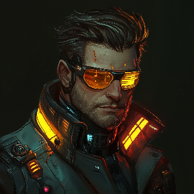
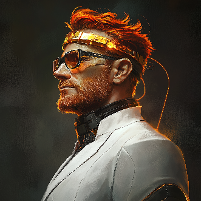
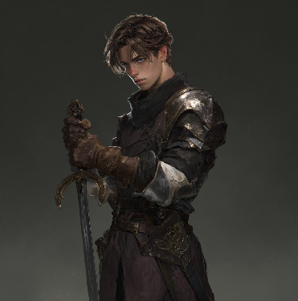
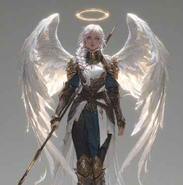
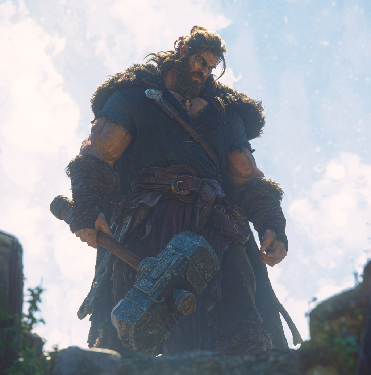

## Humano da Montanha

 

Nativos do continente de Depan e com pele amarelada, prosperam mesmo com seus físicos abaixo da média e pequena expectativa de vida através da criatividade e inovação constantes. Ao longo da história, se tornaram a raça mais avançada cientificamente entre todas, desenvolvendo uma série de meios e caminhos pra se colocar em par ou negociar com as outras raças maiores, mais fortes ou mais rápidas. Essa raça é neutra ao lidar com as outras, visto que não estando tão alto na cadeia alimentar, diplomacia é uma ferramenta inestimável para evitar conflitos e conseguir aliados.  

* **Habilidade:** [Diplomacia](../fatores/#diplomacia)  
* **Vantagens: +1 [INT](../../personagem/atributos/#intelecto-int)**, **+1 [DET](../../personagem/atributos/#determinação-det)**, [Talento Nato](../fatores/#talento-nato), [Especialista](../fatores/#especialista)  
* **Desvantagens: -1 [RES](../../personagem/atributos/#resistência-res)**, [Fraqueza (Fogo)](../fatores/#fraqueza-x)  
* **Línguas:** Humano  

## Humano da Planície

Originários do continente de Bravia, essa raça de humano possui uma pele pálida e vive sob o domínio Imperial dos elfos negros, junto a diversas outras raças. Em razão disso, essa raça tem grande sociabilidade e é amigável com quaisquer outras, independente da origem. Além disso, por viver em sociedades diversas e unidas, tem boas habilidades para trabalho em equipe com qualquer um, além de possuir uma grande quantidade de conhecimento sobre história e a magia das outras raças  

* **Habilidade:** [Sinergia](../fatores/#sinergia), [Interpretação](../fatores/#interpretação)  
* **Vantagens: +1 [INT](../../personagem/atributos/#intelecto-int)**, **+1** **[PER](../../personagem/atributos/#percepção-per)**, [Poliglota](../fatores/#poliglota)  
* **Desvantagens:** [Mental Frágil](../fatores/#mental-frágil)  
* **Línguas:** Humano, Élfico, Bestial  

## Aasimar

Uma raça com longevidade quase eterna, os aasimares são nativos de Depan e se parecem com humanos do norte, mas sempre com cabelos completamente brancos, independente da idade. Com extrema afinidade com magia de luz por natureza, aasimares possuem uma constituição anormalmente forte e uma grande vitalidade, garantindo a eles resistência a venenos. No entanto, a raça tende a buscar isolamento por serem alvos de comerciantes de escravos, de forma que hoje em dia são considerados apenas mitos na maioria das regiões. O seu acelerado metabolismo também implica num grande consumo energético para se sustentar, ficando cansados e com fome mais rapidamente que outras raças  

* **Habilidades:** [Voar](../fatores/#voar)  
* **Vantagens: +2** **[RES](../../personagem/atributos/#resistência-res)**, [Regeneração Natural](../fatores/#regeneração-natural), [Resistência a Venenos](../fatores/#resistência-x), [Linguista Ancião](../fatores/#linguista-ancião), [Longevo](../fatores/#longevo)  
* **Desvantagens:** [Cabeça a Prêmio](../fatores/#cabeça-a-prêmio), [Fraqueza (Escuridão, Luz)](../fatores/#fraqueza-x), [Fraqueza (Contundente)](../fatores/#fraqueza-x), [Alto Metabolismo](../fatores/#alto-metabolismo)  
* **Línguas:** Humano, Demônico  

## Meio-Gigante

Filhos de qualquer raça humanóide com gigantes, os indivíduos dessa raça costumam atingir entre 4 e 6 metros de altura, com um máximo registrado de 7 metros. Geralmente são considerados alguma coisa entre párias e aberrações pela maioria das civilizações, dependendo do contato delas com a raça dos gigantes. Na maioria das vezes, são pessoas que não possuem nenhum dos pais, porque os gigantes não criam seus filhos e geralmente outras raças ou morrem durante o parto de meio-gigantes ou morrem durante sua concepção, rejeitados pela maioria das sociedades, e para lidar com o fato de que sempre vão chamar atenção (geralmente negativa) onde quer que vão, eles compensam com uma força avassaladora, capaz de intimidar a maioria das raças facilmente, além de uma parte das características da raça do pai não-gigante.  

* **Habilidades:** N.A  
* **Vantagens: +1 [RES](../../personagem/atributos/#resistência-res)**, **+1** **[POD](../../personagem/atributos/#poder-pod)**, [Peso Pesado](../fatores/#peso-pesado)  
* **Desvantagens: -1 [INT](../../personagem/atributos/#intelecto-int)**, [Aberração](../fatores/#aberração)  
* **Línguas:** N.A
